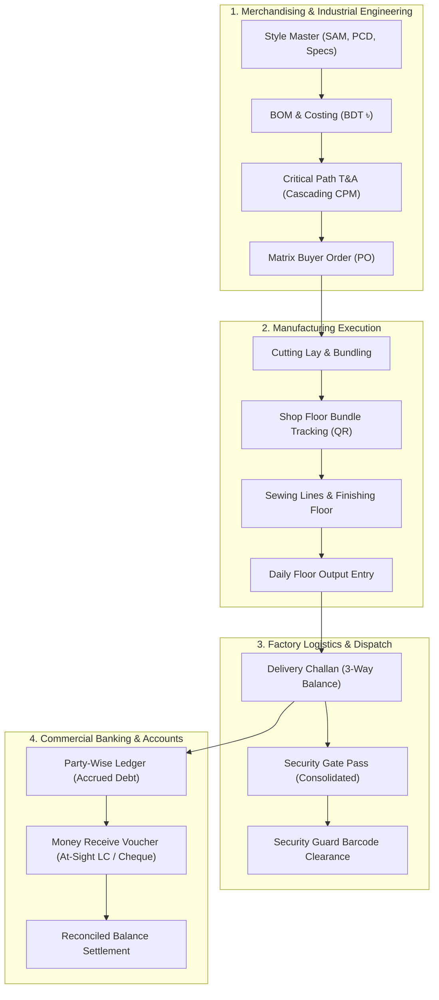

# BloomWorks Garment ERP — Commercial Factory Trial Execution Plan

> **Goal**: Elevate BloomWorks Garment ERP from a software showcase into a production-grade industrial manufacturing and commercial operating system ready for a live trial inside a real Bangladeshi apparel manufacturing plant (e.g., Gazipur / Ashulia / Narayanganj RMG clusters).

---

## Architecture Overview & System Flow

---

## Phase 1: Factory Dispatch, Delivery Challans & Gate Passes

### Objective
Provide physical logistics controls so goods and finished cartons can legally and safely leave factory gates with official documentation matching Bangladeshi EPZ and customs standards.

### 1. Database Architecture
Create two new ORM models in `backend/app/models/logistics.py`:
- **`DeliveryChallan` & `ChallanItem`**:
  - `challan_no`: Unique voucher code (e.g., `BW-DC-26-0885`).
  - `party_name`: Corporate buying house / apparel group (e.g., *M/S Windy Apparels Ltd.*).
  - `delivery_factory`: Physical destination plant / warehouse (e.g., *Vogra Complex, Gazipur*).
  - `pickup_no`: Transport vehicle license / truck registration.
  - `receive_status`: `Not Received` (In-Transit) vs. `Received` (Store signed).
  - `delivery_status`: `All Delivered` vs. `Have Due` (Partial shipment).
  - Item matrix: `order_qty`, `current_delivery_qty`, `previous_delivery_qty`, `balance_due_qty`, `packaging_qty` (cartons/bags).
- **`GatePass` & `GatePassItem`**:
  - `gate_pass_no`: Security voucher code (e.g., `BW-GP-26-0235`).
  - `transport_driver_name` & `phone`.
  - Linked delivery challan IDs.
  - Verification signatures: `prepared_by`, `security_incharge`, `authorized_by`.

### 2. UI & Printable Document Engine
- **Order Delivery Registry (`/deliveries`)**:
  - Filter by company, Challan No, receive status (`Received` / `Not Received`), and delivery status (`All Delivered` / `Have Due`).
  - Modal to record new deliveries against open Buyer Orders.
- **A4 Printable Templates (`window.print()` & clean CSS)**:
  - **Delivery Challan Voucher**: Machine-readable Code128 barcode, buyer PO references, 3-way delivery balance matrix, packaging carton count.
  - **Security Gate Pass**: Security checkpoint barcode, list of consolidated challans, total carton count, and tripartite signature blocks.

---

## Phase 2: Commercial Accounts Receivable & Money Receipts (MR)

### Objective
Reconcile factory revenue, track client debt, and handle authentic Bangladeshi export-import commercial instruments (At-Sight LC, Back-to-Back LC, Bank Cheques, Cash).

### 1. Database Architecture
Create `CommercialPayment` in `backend/app/models/commercial.py`:
- `voucher_no`: Money Receipt number (e.g., `BW-MR-26-0001`).
- `party_id` & `buyer_id`.
- `payment_method`: `At-Sight LC`, `Deferred LC`, `Cheque`, `Cash`, `Bank Wire`.
- `amount`: Invoiced payment amount (supporting both BDT `৳` and USD `$`).
- `lc_number` & `bank_advice_ref`: Bank realization document identifier.
- `attachment_url`: Scanned bank deposit slip or LC realization advice.
- `amount_in_words`: Automated English capitalized currency representation.

### 2. Frontend Accounting & Financial Ledgers
- **Party-Wise Debt & Aging Ledger (`/reports/party-ledger`)**:
  - Top summary cards: **Total Quantity Shipped**, **Total Invoiced**, **Received Amount**, and **Net Outstanding Due**.
  - Challan-by-challan running debt balance accumulator.
- **Create Money Receive Form**:
  - Selecting a party automatically queries and populates their live outstanding balance.
  - Attachment file uploader for physical deposit slips.
- **Money Receive Registry**:
  - Audit log with quick-view document attachments and payment method tags.

---

## Phase 3: Industrial Engineering (SAM) & Style Master Modernization

### Objective
Bridge the gap between merchandising and factory line loading by incorporating Standard Allowed Minutes (SAM), planned cut dates, and the 9-stage garment lifecycle.

### 1. Model Enhancements on `Style`
- **Engineering (IE)**: `sam_minutes` (e.g. 14.5 min), `target_efficiency_pct` (e.g. 65%), `value_additions` (tags: Wash, Print, Embroidery).
- **Milestones**: `ocd_date` (Order Confirmation), `pcd_date` (Planned Cut Date), `ex_factory_date`.
- **Accountability**: `pd_merchant_name` (Development), `prod_merchant_name` (Bulk Floor).
- **Commercials**: `costing_qty`, `projection_qty`, `placement_qty`, `target_fob_bdt`.

### 2. Frontend Workspaces
- **9-Stage Interactive Pipeline Ribbon**: Quick filtering across `Total`, `Design`, `Product Dev`, `Projection`, `On-Order`, `Key Styles`, `Pending POs`, `Un-Shipped`.
- **4-Tab Industrial Intake Form**:
  - Tab 1: General & Buyer Identification.
  - Tab 2: Industrial Engineering (SAM, Efficiency %, OCD, PCD, Ex-Factory).
  - Tab 3: Order Quantities & Commercials (in ৳ BDT).
  - Tab 4: Garment Specs, Value Additions & Color Matrix.
- **Style 360° Cockpit**: Direct access to BOM consumption, T&A milestone health, and internal/buyer communication threads.

---

## Phase 4: Production-Grade Seed Data & Pitch Verification

### Objective
Ensure that anyone inspecting the live site encounters an active, bustling garment factory with coherent figures across all departments.

### 1. Factory Seed Dataset (Gazipur RMG Context)
- **Top Tier Buyers**: H&M (Sweden), Inditex/Zara (Spain), Primark (UK), Marks & Spencer, Target (USA).
- **Local Industry Partners**: M/S Windy Apparels Ltd., Rowa Fashions Ltd., Vintage Garments Ltd., DBL Spinning Mills.
- **Running Garment Programs**:
  - Style `#BW-POLO-101`: 100% Combed Cotton Pique Polo (SAM: 12.8 min, Order: 15,000 pcs, Delivery: All Delivered).
  - Style `#BW-CRG-204`: 6-Pocket Twill Utility Cargo Pants (SAM: 19.5 min, Order: 10,000 pcs, Delivery: Have Due - 4,000 pcs balance).
  - Style `#BW-HD-305`: Heavyweight French Terry Hoodie with Silicon Wash (SAM: 16.2 min, Order: 8,000 pcs, Status: In Production).
- **Financial Balance**: Complete commercial ledger showing historical challans, payments received via At-Sight LC, and active outstanding balances.

### 2. Live Verification & Hardening
- Automatic schema migration and seeding on cold Vercel serverless starts.
- Clean print previews configured in CSS (`@media print`) so physical paper prints on standard A4 printers look crisp without header/footer artifacts.
